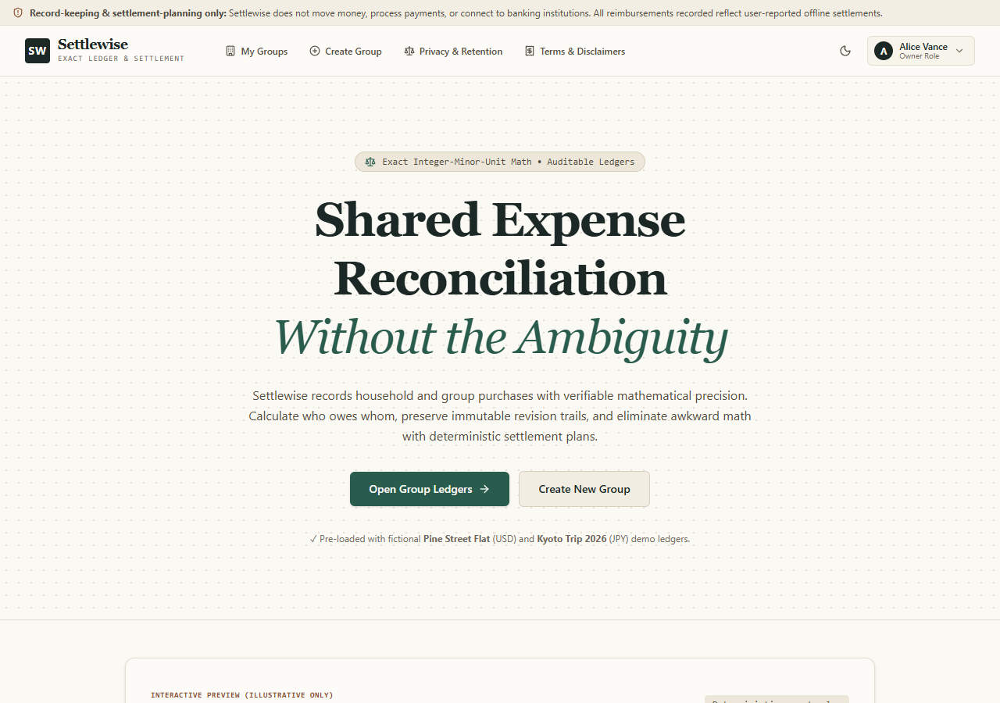
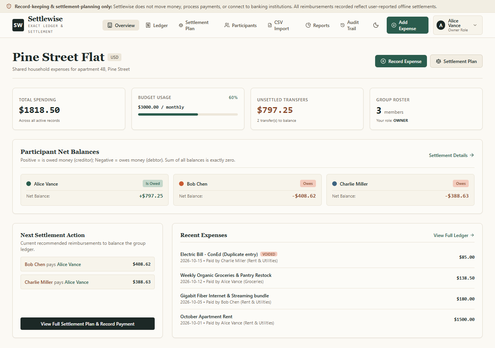
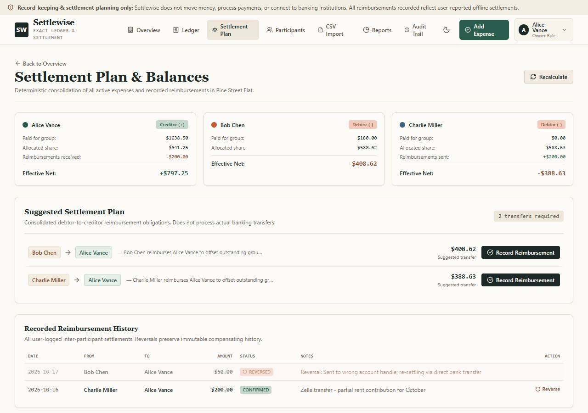

# SettleWise

[](https://settlewise-g3-8.vercel.app)
[](https://github.com/devtechedge/settlewise_g3.8/actions/workflows/ci.yml)
[](LICENSE)

Shared-expense reconciliation with bank-grade integer arithmetic, an immutable revision trail, and a deterministic settlement planner.

SettleWise records who paid, who owes, and exactly how much, in integer minor units (cents, pence, paise, yen) so no floating-point rounding ever touches a balance. It never moves money. It is a record-keeping and settlement-planning tool, not a bank or payment processor.

## Live Demo

**Try it now: https://settlewise-g3-8.vercel.app**

> Demo mode runs on an in-memory PostgreSQL (PGLite) seeded with two sample ledgers on first request. The demo database resets when a cold start occurs, so explore freely. Data you add is not persistent.
>
> You are signed in as Alice Vance (Owner) by default. Use the role switcher in the top-right corner to explore Bob Chen (Editor) and Charlie Miller (Member) permissions.

## Screenshots

| Landing | Group overview | Settlement plan |
| --- | --- | --- |
|  |  |  |

More: [Login](docs/screenshots/02-login.png), [Groups](docs/screenshots/03-groups.png), [Ledger](docs/screenshots/05-ledger.png).

## What it does

- Exact monetary arithmetic stored as integer minor units, never floats
- Deterministic allocation engines: Equal, Exact, Percentage (basis points), and Shares (weights), with largest-remainder distribution for odd splits
- Deterministic greedy settlement planner that consolidates debts into the minimum set of transfers
- Immutable expense revision history with before/after snapshots and required audit reasons
- Optimistic concurrency control on ledger edits to prevent lost updates
- Reversible offline settlement payments with idempotency keys
- CSV import with RFC 4180 parsing, duplicate fingerprinting, and preview-before-commit
- CSV export sanitization against spreadsheet formula injection (cells starting with `=`, `+`, `@`, tab, or CR are neutralized)
- Immutable audit trail of every group, expense, and payment event
- 15-table relational schema with role-based access (Owner, Editor, Member)

## Tech stack

| Layer | Choice |
| --- | --- |
| Framework | Next.js 15 (App Router) |
| UI | React 19, Tailwind CSS v4 |
| Language | TypeScript (strict) |
| Database | PostgreSQL via Drizzle ORM |
| Demo database | PGLite (in-memory PostgreSQL) |
| Auth | Firebase Authentication + demo personas |
| Tests | Node test runner via Bun |

## Getting started

Requires Node.js 20+ and Bun 1.x.

```bash
bun install
bun run dev
```

Open http://localhost:3000. The app runs in demo mode by default with seeded data, so no database setup is needed to explore.

### Persistent PostgreSQL

To run against your own PostgreSQL database:

1. Set `DEMO_MODE=false` and provide the SQL_* variables shown in `.env.example`.
2. Run migrations with `bunx drizzle-kit push` (or `bunx drizzle-kit generate` then `push`).
3. Start the app. The same seed data is created on first run when the database is empty.

## Tests

```bash
bun test
```

## Windows local builds

Bun skips platform-specific optional binaries on Windows (`lightningcss`). The `postinstall` step restores the required binary automatically from the pinned `lightningcss-win32-x64-msvc` devDependency. If you ever see `Cannot find module '../lightningcss.win32-x64-msvc.node'`, run `bun install` again, or manually:

```bash
node scripts/ensure-windows-native.mjs
```

The suite covers money parsing and formatting, allocation invariants, zero-sum balances, settlement planning, reversal behavior, CSV parsing, duplicate fingerprints, and formula-injection sanitization.

## Project structure

```
domain/       Pure business logic: money, allocations, balances, planner, CSV
src/db/      Drizzle schema and database bindings
services/    Application services over the domain layer
app/         Next.js App Router pages and API routes
components/  React components
tests/       Node test runner suites
```

## Not included

SettleWise does not process payments, connect to banking networks, store card numbers, or offer financial advice. All settlement records reflect offline, user-reported reimbursements. Terms and privacy documents are linked from the app footer.

## License

MIT
